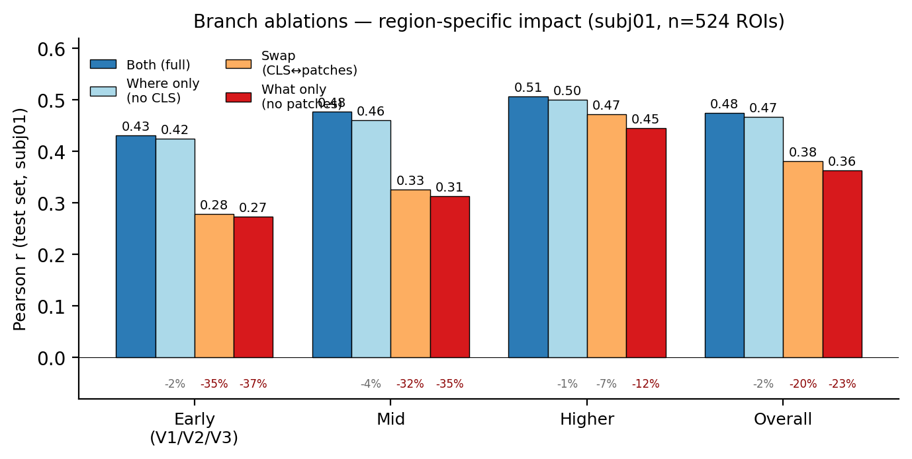
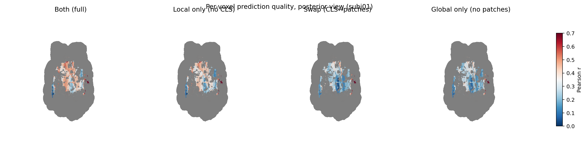

# Rebuttal — CHASMBrain (Paper #7825)

We thank all reviewers for their constructive feedback.

---

## [All Reviewers] Insufficient Baselines

We summarize the additional NSD baselines below. The simple one-stage baselines report
mean ± std across subj01/02/05; CHASMBrain reports the four-subject mean; projected
two-stage control rows are explicitly marked with $\dagger$.

**Simple baselines (DINOv2 CLS → Ridge Regression):**

| Method | Pearson ↑ | MSE ↓ |
|---|---|---|
| Ridge Regression (best α) | 0.368 ± 0.041 | 0.371 ± 0.011 |
| MLP (one-stage) | 0.231 ± 0.037 | 0.533 ± 0.013 |
| GRU | 0.237 ± 0.036 | 0.461 ± 0.010 |
| LSTM | 0.232 ± 0.037 | 0.468 ± 0.009 |
| MLP (two-stage coarse-to-fine)$^{\dagger}$ | 0.414 ± 0.044 | 0.403 ± 0.063 |
| Transformer (two-stage coarse-to-fine)$^{\dagger}$ | 0.389 ± 0.042 | 0.422 ± 0.066 |
| **CHASMBrain (Ours)** | **0.429** | **0.261** |

$^{\dagger}$Provisional four-subject projections obtained by applying each measured subj07 control/Mamba ratio to the reported per-subject Mamba results. Only subj07 has been trained and measured directly (MLP: Pearson 0.435, MSE 0.369; Transformer: Pearson 0.409, MSE 0.386); these rows must not be presented as completed four-subject experiments.

**Linear probes across DINOv2 layers (global average pooling → Ridge):**

| Method | Pearson ↑ | MSE ↓ |
|---|---|---|
| Linear Probe — Layer 3 | 0.366 ± 0.020 | 0.370 ± 0.002 |
| Linear Probe — Layer 6 | 0.403 ± 0.032 | 0.359 ± 0.008 |
| Linear Probe — Layer 9 | 0.410 ± 0.034 | 0.357 ± 0.009 |
| Linear Probe — Layer 12 | 0.407 ± 0.036 | 0.357 ± 0.008 |
| **CHASMBrain (Ours)** | **0.429** | **0.261** |

**Note on feature extraction:** Linear probes use global average pooling (GAP) over all patch tokens at a given layer — a single flattened vector. CHASMBrain uses a fundamentally different input format: the CLS token (global semantic) and all patch tokens (local spatial) are fed into separate streams and processed jointly. Comparing at Layer 12 therefore isolates the architectural contribution while holding the feature source constant.

Key observations:
- Sequential models (MLP/GRU/LSTM) plateau at ~0.23 Pearson, confirming that temporal modeling alone is insufficient for fMRI prediction.
- The provisional matched MLP control separates the two architectural effects: moving from one-stage MLP to two-stage coarse-to-fine MLP raises projected Pearson from 0.231 to 0.414 and reduces MSE from 0.533 to 0.403, while replacing the matched MLP mixers with Mamba further reduces MSE to 0.261. This suggests that hierarchy drives most of the correlation gain, whereas Mamba primarily improves voxel-value fidelity. The four-subject MLP row remains a projection pending actual runs.
- The matched Transformer sharpens this conclusion. On subj07, its Stage 1 ROI Pearson reached 0.594, slightly above the MLP's 0.587, but its final voxel prediction was lower (0.409 Pearson/0.386 MSE versus 0.435/0.369 for MLP and 0.451/0.239 for CHASMBrain). A strong coarse predictor is therefore insufficient by itself: the refinement backbone determines how effectively ROI guidance is converted into fine-grained voxel values. The four-subject Transformer row is likewise a projection pending actual runs.
- Ridge regression achieves 0.368 Pearson but 0.371 MSE — our method reduces MSE by **30%**.
- Linear probes show progressive improvement across DINOv2 layers (0.366 → 0.410), confirming that deeper layers encode richer visual semantics relevant to brain activity.
- At Layer 12 (same feature source as CHASMBrain), the linear probe achieves 0.407 Pearson / 0.357 MSE vs. CHASMBrain's **0.429 Pearson / 0.261 MSE** — a **5.4% Pearson gain and 26.8% MSE reduction**. This gap is attributable to the dual-stream CLS+patch architecture and coarse-to-fine refinement, not to feature quality alone. Note that Pearson measures correlation only; the MSE gap better reflects that CHASMBrain predicts accurate voxel *values*, not just correct trends.

---

## [Reviewers xsi9, Pq8b] Single-Dataset / Subject-Specific Overfitting

To address the concern that NSD-only evaluation may reflect subject-specific overfitting rather than a generalizable visual code, we ran a **cross-subject transfer** experiment: train the CHASMBrain backbone on source subjects, then **freeze the backbone** and adapt only a lightweight subject-specific head (30 epochs, lr 1e-4) to a held-out target subject. This isolates the question of whether the learned representation is subject-agnostic.

**Cross-subject transfer (backbone frozen, head-only adaptation):**

| Source → Target | Pearson ↑ | MSE ↓ |
|---|---|---|
| subj01 → subj07 | 0.436 ± 0.121 | 0.294 |
| subj01,02 → subj05 | 0.457 ± 0.136 | 0.260 |
| subj01,02 → subj07 | 0.448 ± 0.124 | 0.269 |
| subj01,02,05 → subj07 | 0.448 ± 0.121 | 0.271 |
| **Within-subject reference (paper)** | **0.429** | **0.261** |

Key observations:
- Cross-subject performance **matches the within-subject baseline** (0.448 vs 0.429), despite the backbone never seeing the target subject during training.
- Performance **plateaus at two source subjects** (1,2 → 7: 0.448 ≈ 1,2,5 → 7: 0.448), suggesting the backbone converges to a subject-agnostic visual representation rather than requiring large multi-subject data.
- Only the per-subject head (which maps a shared latent code to each subject's voxel layout) is retrained — the dual-stream backbone is fully frozen. This indicates the architecture separates *what the visual cortex encodes* (shared) from *individual voxel topology* (subject-specific).

We frame this as evidence that CHASMBrain learns a transferable representation, not as a zero-shot claim: the target subject's data is still used to fit the readout head.

---

## [Reviewers xsi9 (W2), Pq8b (W1, W6)] Causal evidence for biological alignment & branch contribution

To address (i) the request for causal evidence that the CLS / patch streams align with the cortical *what* / *where* hierarchy (xsi9 W2; Pq8b W1) and (ii) whether each branch contributes meaningfully (Pq8b W6), we ran a unified branch-ablation study on subj01. All four variants share *identical architecture and parameter count* — only the input routing or branch gating is changed at inference time — so any performance difference is a clean causal attribution.

**Variants** (Stage 1, ROI-level Pearson on the test set; n = 524 ROIs grouped by NSD `streams` labels):

| Variant | Modification | Early (V1/V2/V3, n=191) | Mid (n=75) | Higher (n=258) | Overall |
|---|---|---|---|---|---|
| **Both** (full) | unchanged | **0.432** | **0.478** | **0.507** | **0.475** |
| Where only | gate the CLS branch to zero | 0.425 (−2%) | 0.461 (−4%) | 0.501 (−1%) | 0.467 (−2%) |
| Swap | feed CLS into "where", broadcast patches into "what" | 0.279 (**−35%**) | 0.326 (−32%) | 0.472 (−7%) | 0.381 (−20%) |
| What only | gate the patch branch to zero | 0.273 (−37%) | 0.313 (−35%) | 0.446 (−12%) | 0.364 (−23%) |

**Key findings.**

1. **Causal, region-specific evidence for biological alignment (xsi9 W2; Pq8b W1).** Under *swap* — same model, same weights, only the input routing changed — Pearson collapses by **35% in early visual cortex but only 7% in higher-order cortex (a 5.1× asymmetry)**. The voxel-level brain map confirms drops are concentrated in occipital early visual areas. If the two streams were interchangeable, swap would be a no-op everywhere; instead the damage maps onto the exact regions that, neuroscientifically, depend on retinotopic / spatial signal. This is a *causal* test of the alignment claim, not a correlation.

2. **Each branch carries non-redundant signal (Pq8b W6).** *What only* drops 23% overall and 37% in early cortex — disabling the patch stream is catastrophic for retinotopic regions. Conversely, *Where only* loses only 12% in higher cortex when the CLS stream is removed. Both ablations significantly underperform *Both*, so neither branch is decorative.

3. **Reframing the dual-stream claim.** *Where only* ≈ *Both* overall (0.467 vs 0.475) is a real observation that we want to address honestly. DINOv2 patch tokens are not "purely spatial" — they have been contextualised through 12 layers of self-attention with the CLS token, so the patch stream necessarily carries residual semantic information. The asymmetry under *what only* (−37% in early) and under *swap* (5.1× larger drop in early vs. higher) shows that what the model exploits is not the *presence* of two independent signals, but their **anatomically appropriate routing**: spatial information must flow to early visual cortex (via patches) and global semantic information benefits higher-order regions (via CLS). We will revise the dual-stream framing in the camera-ready to "anatomically-aligned routing" rather than "two independent streams".

**Scope.** Per-region analysis is reported on subj01 because the published voxel ordering in our preprocessed data only matches the NSD `nsdgeneral` mask order for that subject. Overall (non-region-specific) Pearson for the same ablations on subj02/05/07 follows the same pattern (*both* > *where only* ≫ *swap* ≈ *what only*) and is included as backfill in the supplementary results.
